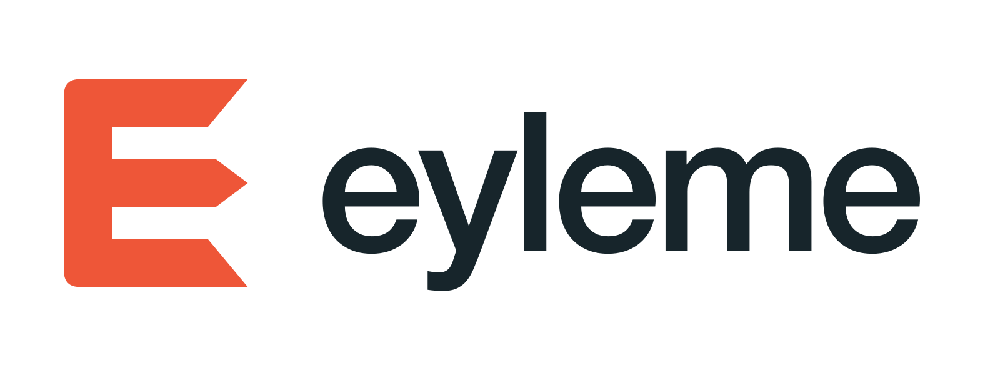

  <picture>
    <source media="(prefers-color-scheme: dark)" srcset="assets/eylema-logo/logo-dark.png">
    
  </picture>

# Eylema

**Basit, Performanslı Eylemci Yapay Zeka Sürekli Geliştirme ve İşletme Web Platformu.**

Kod, kimlikler, dosya adları ve katkı şablonları İngilizcedir. Dokümantasyon [İngilizce](README.md) ve Türkçe sunulur; kaynak dil İngilizcedir. **Eylema** ürün adı **11 Ekim 2026** tarihinde kabul edildi; yukarıdaki tanım ürünün amacını anlatır.

Herkese açık çekirdek proje deposu [eylema-dev/eylema](https://github.com/eylema-dev/eylema), [eylema-dev organizasyonundadır](https://github.com/eylema-dev). Paket öneki ve native başlangıç host’u `eylema`; help/version yerelde çalışır, görev/servis işlemleri ve yayın sonraki kapılardır. Proje sahibi 11 Ekim 2026 tarihinde **`eylema.dev` alan adını GoDaddy üzerinden kaydettiğini** bildirdi. Lisans seçimi henüz tamamlanmadı.

`eylema-dev` organizasyonu ve bu public depo 11 Ekim 2026 tarihinde oluşturuldu. [İsim ve uygunluk kaydı](https://github.com/eylema-dev/devguide/blob/main/docs/tr/name-availability.md), organizasyon oluşturulmadan önceki kontrolleri ve sonraki alan adı güncellemesini korur. Ana alan adı `eylema.dev`; alan adı kaydı, platformun yayımlandığı veya kabul edildiği anlamına gelmez.

Marka dosyaları: [SVG / PNG logolar ve kullanım kılavuzu](assets/eylema-logo/README.tr.md), [önizleme](assets/eylema-logo/brand-preview.png), [logo paketini indir](assets/eylema-logo.zip).

**Durum: birinci taraf Rust sözleşmeleri, kanonik codec ve deterministik gömülü görev çekirdeği.** [G10 yürütücü kanıtı](docs/tr/deterministic-runtime.md) sınırlı native kabul/adım/olay ve gerçek sahipli durumu; [G09 codec/platform kanıtı](docs/tr/codec-platform.md) gerçek native/Node içinde Wasm karşılaştırmasını kapsar. [G07 workspace kanıtı](docs/tr/rust-workspace.md) gerçek native derleme/süreç testlerini ve seçilen taşınabilir kütüphanenin Wasm derlemesini kapsar. Depo CI’ı belge/şema/PR doğrulamasının yanında artık Rust kapılarını çalıştırır; genel görev konsolu, kalıcılık, insan gözetimi, model yürütümü, otonom geliştirme ve performans kabulü sonraki Goal’lerde kalır.

## Katkıda bulunma

[Katkı kuralları](https://github.com/eylema-dev/devguide/blob/main/CONTRIBUTING.tr.md) ve ortak [AI eylemci sözleşmesi](https://github.com/eylema-dev/devguide/blob/main/AGENTS.md) ile başlayın. [İlk sürüm yol haritasını](https://github.com/eylema-dev/eylema-docs-tr/blob/main/docs/roadmap.md), [kalite kontrollerini](https://github.com/eylema-dev/devguide/blob/main/docs/tr/quality-gates.md) ve [CI araç envanterini](https://github.com/eylema-dev/devguide/blob/main/docs/tr/tooling.md) izleyin. Issue/PR şablonları kapsam, kabul koşulları ve kanıt toplar. Bakımcı incelemesi CI’dan ayrıdır; bu dosyalar zorunlu kontrol dal kurallarını etkinleştirmez.

## Ürün yönü

AI ekiplerinin açık ve incelenebilir sözleşmelerle geliştirebildiği ve işletebildiği uçtan uca bir web platformu. Uygulamalar durumunu, hedeflerini, eylemlerini, yetkilerini, bütçelerini ve kabul koşullarını tanımlar. İnsan katılımı, gözetimi ve komutası aynı sistemin kullanılabilir yetenekleridir.

- Web, veri, eylemci, hesaplama ve araçlar için kendi Rust üretim bileşenlerimiz; seçilebilir 3B, yerel dil, karar ve dünya modeli yetenekleri.
- İlk deneysel sürümde tek M4 Pro/24 GB cihazda tarayıcı Rust/Wasm/WebGPU ve native macOS CPU/Metal; Linux ve ikinci fiziksel cihaz kabulü sonraki kapsamdır.
- İhtiyaçtan PR’a standart protokol kullanan büyük model geliştirme ekipleri.
- Donanıma göre seçilen, sürümlenen ve ortak uygulama yükünde değerlendirilen yerel model takımları.
- İzinli deneyim, insan düzeltmesi ve gerçek sonuçlardan kürasyonla oluşturulan eğitim verileri.
- Eğitim/paketleme hattında açık dış araç olarak Unsloth; model kabulünden önce kendi motorumuzda doğrulama.
- Kod, veri, değerlendirme, eğitim tarifi, model ve donanım profili için açık katkı sözleşmeleri.

## “Dünyanın en iyisi” hedefinin kanıtı

Amaç AI ile web geliştirme ve işletmede öncü platformlardan biri olmaktır. Bu hedef mevcut bir sıralama veya her koşulda üstünlük sözü değildir. Kamuya açık karşılaştırmalar donanımı, iş yükünü, kalite eşiğini, sürümleri, yapılandırmayı, sınırları ve yeniden üretilebilir sonuçları paylaşmalıdır.

| Boyut | Aranacak kanıt |
|---|---|
| AI ile geliştirme | Ayrılmış değişiklik görevlerinde doğru tamamlama; düzeltme sayısı, süre, model maliyeti ve insan müdahalesi |
| Uygulama güvenilirliği | Uçtan uca davranış, kayıt/kurtarma, yetki, yükseltme ve açık hata sonuçları |
| Birlikte çalışma performansı | Sahne kare süresi p95/p99, eylem/görev gecikmesi, kalite, tepe bellek, başlangıç ve ölçülebilen enerji |
| Karar ve dünya modelleri | Kapalı döngü görev başarısı, kısıt ihlali, çok adımlı tahmin hatası ve deterministik başlangıca karşı sonuç |
| Sürekli öğrenme | Bağımsız görevlerde karşılaştırılabilir kaynak bütçesiyle iyileşme; gerilemeler ve başarısız adaylar dâhil |
| İnsan denetimi | Etkili onay, izleme, müdahale ve yetki geri alma; ölçülen müdahale sınırları ve anlaşılır kanıt |
| Basitlik ve genişletilebilirlik | İlk çalışan uygulama, kavram/API kapsamı, bağımsız katkı başarısı, hedefler ve bağımlılık envanteri |

Hız veya maliyet iyileştirilmeden önce asgari kalite karşılanır. Kernel yanında tamamlanmış uygulama sonuçları karşılaştırılır; soğuk ve sıcak çalışma ayrı raporlanır. Tek bir yapay puan ödünleşimleri gizlememelidir. Kıyas araçları ve referans uygulamalar üretim bağımlılığı sınırının dışındadır. Sayısal hedefler ilk iş yükü ve donanım seçimiyle belirlenir.

## Güncel belgeler

| Belge | İngilizce kaynak | Türkçe karşılık |
|---|---|---|
| Proje yapısı 0.2.0 | [First application and component proposal](https://github.com/eylema-dev/eylema-docs-en/blob/main/docs/project-structure.md) | [İlk uygulama ve bileşen önerisi](https://github.com/eylema-dev/eylema-docs-tr/blob/main/docs/project-structure.md) |
| Mimari 0.4.0 | [Architecture](https://github.com/eylema-dev/eylema-docs-en/blob/main/docs/architecture.md) | [Mimari](https://github.com/eylema-dev/eylema-docs-tr/blob/main/docs/architecture.md) |
| API ve denetim 0.2.0 | [API reference](https://github.com/eylema-dev/eylema-docs-en/blob/main/docs/api-reference.md) | [API referansı](https://github.com/eylema-dev/eylema-docs-tr/blob/main/docs/api-reference.md) |
| Geliştirme ve işletim 0.2.0 | [Team protocols](https://github.com/eylema-dev/eylema-docs-en/blob/main/docs/development-and-operations.md) | [Takım protokolleri](https://github.com/eylema-dev/eylema-docs-tr/blob/main/docs/development-and-operations.md) |
| Öğrenme ve eğitim 0.2.0 | [Learning protocol](https://github.com/eylema-dev/eylema-docs-en/blob/main/docs/learning-and-training.md) | [Öğrenme protokolü](https://github.com/eylema-dev/eylema-docs-tr/blob/main/docs/learning-and-training.md) |

Makinece okunabilir taslaklar: [geliştirme isteği şeması](ai-team-protocol/request.schema.json), [örnek istek](ai-team-protocol/request.example.json), [macOS model-set 0.2.0 şeması](ai-team-protocol/v0.2/model-set-release.schema.json), [sentetik aday](ai-team-protocol/v0.2/model-set-release.example.json), [korunmuş tarihsel 0.1.0 şeması](ai-team-protocol/model-set-release.schema.json). Şemaya uygunluk, yetki veya başarılı çalışma kanıtı değildir.

İşlem kimlikleri, yollar, alanlar, enum değerleri ve hata kodları iki dilde aynı İngilizce tanımları kullanır. Güncel belgeler `eylema-docs-en` ve `eylema-docs-tr` depolarının `docs/` dizinlerinde eşleşen İngilizce dosya adları taşır; çeviriler kaynak sürümünü izler. Önceki Türkçe mimari sürümleri ve ilk API özeti tarihsel kayıt olarak `eylema-docs-tr/archive/` altında korunur. Düzen ve taşıma notları [proje yapısı belgesindedir](https://github.com/eylema-dev/eylema-docs-tr/blob/main/docs/project-structure.md).

## İlk kanıt

Seçilen ilk çalışan uygulama bir görev konsoludur: görev oluşturma, deterministik adımları çalıştırma, ilerlemeyi inceleme, kalan işi durdurma, durumu kaydetme ve hizmet yeniden başladıktan sonra tekrar açma. Önce Rust sözleşmeleri, yürütücü ve günlük kurulur, ardından asgari web arayüzü gösterilir. [Kabul senaryoları ve önerilen bileşenler](https://github.com/eylema-dev/eylema-docs-tr/blob/main/docs/project-structure.md), gösterimin neyi kanıtlaması gerektiğini tanımlar.

Sonraki 3B ortam, öğrenilmiş politika/dinamik modeli, yerel dil modeli, izinli eğitim döngüsü ve geliştirme takımının PR akışı ayrı yol haritası aşamalarıdır. İlk tarayıcı gösterimi model erişimi veya GPU gerektirmez. G07 başlangıcı yalnız help/version sunar; çalışan görev konsolu akışı hâlâ G08–G17 gerektirir.

## Organizasyon depoları

[İngilizce ürün belgeleri](https://github.com/eylema-dev/eylema-docs-en) · [Türkçe ürün belgeleri](https://github.com/eylema-dev/eylema-docs-tr) · [Geliştirici rehberi](https://github.com/eylema-dev/devguide) · [Depo haritası](https://github.com/eylema-dev/devguide/blob/main/docs/tr/repository-map.md)

`eylema`; ilk Rust workspace/başlangıç host’unu, gelecek görev CLI/bileşenlerini, makine şemalarını ve mevcut marka varlıklarını sahiplenir. Ürün metinleri dil depolarına, ortak katkı politikası devguide'a taşınır. Örnekler, değerlendirmeler, model üstverileri ve eğitim tarifleri için açıkça iskelet aşamasında ayrı depolar vardır. Web sitesi [eylemadotdev](https://github.com/eylema-dev/eylemadotdev) içinde ayrı yönetilir. Bu bölünmeyle çalışma zamanı uygulanmış değildir.

[Taşıma kaydı](https://github.com/eylema-dev/devguide/blob/main/docs/tr/repository-migration.md) kaynakları, hedefleri, ilişkili PR'ları, entegrasyon kontrollerini ve geri dönüşü açıklar. Yeni belge bağlantıları eşgüdümlü birleştirme sonrası yerleşimi hedefler; öncesinde PR'lar ve sabitlenmiş depo kümesi inceleme kopyalarını sağlar.
