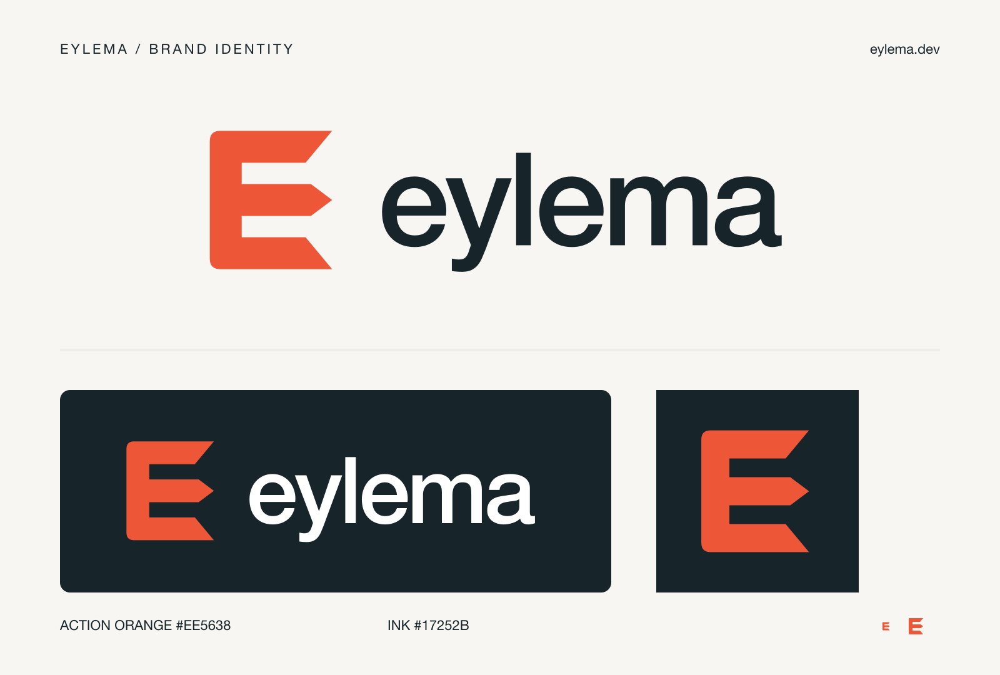

# Eylema identity

[Türkçe](README.tr.md) · [Download the complete pack](../eylema-logo.zip)

The **E / action** mark combines Eylema's initial with a forward-pointing centre. Its angled terminals suggest movement; the rounded left corners soften the silhouette. The lowercase wordmark keeps the identity approachable.

| Color | Hex | Use |
|---|---|---|
| Action orange | `#EE5638` | Mark and accents |
| Ink | `#17252B` | Wordmark and dark backgrounds |
| White | `#FFFFFF` | Reversed wordmark |
| Paper | `#F7F6F2` | Presentation background |

## Files

| File | Use |
|---|---|
| `logo.svg` / `logo.png` | Horizontal lockup for light backgrounds; transparent PNG, 1600 px wide |
| `logo-dark.svg` / `logo-dark.png` | Horizontal lockup for dark backgrounds; transparent PNG, 1600 px wide |
| `logo-mono.svg` / `logo-mono.png` | Single ink color; transparent PNG, 1600 px wide |
| `logo-icon.svg` / `logo-icon.png` | Standalone mark; transparent PNG, 1024 × 1024 |
| `github-avatar.svg` / `github-avatar.png` | Avatar with an opaque ink background and room for circular cropping; 1024 × 1024 |
| `github-social.svg` / `github-social.png` | Repository social preview; 1280 × 640 |
| `favicon-16.png`, `favicon-32.png`, `favicon-48.png` | Small web icons |
| `apple-touch-icon.png` | Opaque touch icon; 180 × 180 |
| `brand-preview.svg` / `brand-preview.png` | Overview of the actual artwork; 1600 × 1080 |

SVGs are the editable source. They contain no external images, fonts, scripts, gradients or filters. The wordmark uses `'Helvetica Neue', Arial, sans-serif`; installed fonts may affect SVG text rendering. The checked-in PNGs preserve the rendered appearance. No font binaries are distributed.

Keep the proportions and colors intact. Preserve at least one stem-width of clear space around the mark. Use the standalone mark at small sizes; do not squeeze the full wordmark into a favicon. Use the avatar file when uploading to a profile with a circular crop. A stored avatar or social image is an upload-ready asset, not evidence that an account setting was changed.

## Rebuild

With Node.js and `sharp` available, run `node tools/render-brand.cjs` from the repository root. The script renders the canonical SVGs and builds the overview and social image using their exact geometry. It does not change the five source SVGs. The initial export used sharp 0.35.5. If dependencies live elsewhere, set `NODE_PATH` to that installation's `node_modules` directory. Rebuild the zip from this directory after changing assets.

Brand assets identify Eylema. A repository license has not yet been selected; this package does not grant a trademark license or make a trademark-clearance claim.
